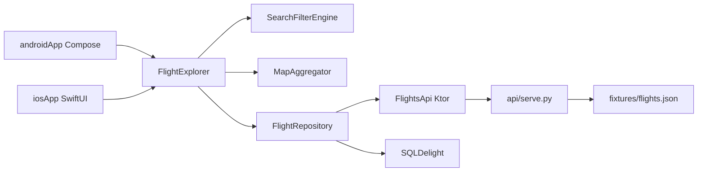

# Flight Explorer — submission notes

## What shipped

Dual native UIs (Jetpack Compose + SwiftUI) over a shared KMP data/domain layer, driven by a single `FlightExplorer` facade. Local Python API on port 8080 serves the provided `fixtures/flights.json` (1000 flights).

## Architecture



**Why this shape**

- **Facade + StateFlows** — list/map/saved stay in parity without duplicating filter or selection rules per platform.
- **SQLDelight** — typed shared schema for flight cache + saved upserts; works offline.
- **Ktor + serialization** — one HTTP/JSON path for Android (OkHttp) and iOS (Darwin).
- **MapLibre (Android)** — destination map without a Google Maps API key (MapLibre GL JS in a WebView).
- **MapKit (iOS)** — native annotations + polyline for the selected route.

## Assumptions

- “Route” on the map is a straight origin→destination polyline (not a real airway).
- Default discovery date window is the fixture span `2027-02-01`…`2027-04-01` so results appear immediately.
- Multi-program filters are OR within the program dimension; cabin/date/points/origin/dest AND across dimensions.
- Android emulator reaches the host API at `10.0.2.2:8080`; iOS simulator at `127.0.0.1:8080`.

## Tradeoffs

| Choice | Tradeoff |
|--------|----------|
| MapLibre via WebView | Faster to ship without native MapLibre SDK / tokens; slightly heavier WebView vs native GL |
| 250ms text debounce | Snappy typing vs one extra quarter-second before filter apply |
| jvmTest (not commonTest android) | Runs on CI/desktop without emulator; same domain + SQLDelight + mock Ktor |
| Python stdlib HTTP server | One-command local API; not production-hardened |

## Verification

**Automated**

```bash
export JAVA_HOME="/Applications/Android Studio.app/Contents/jbr/Contents/Home"
./gradlew :shared:jvmTest   # green — filter bounds, aggregation, persistence, offline stale
./gradlew :androidApp:assembleDebug   # green on this Mac mini
```

**API smoke**

```bash
python3 api/serve.py
curl -s http://127.0.0.1:8080/flights | python3 -c "import sys,json; print(len(json.load(sys.stdin)['flights']))"
# → 1000
```

**Manual checklist (Android emulator)**

- [ ] Debounced origin/dest typing
- [ ] Chips + reset
- [ ] List/map selection parity + route line
- [ ] Save / remove honesty + saved row bookmarks
- [ ] Kill API → OfflineStale banner + cached search/saved
- [ ] TalkBack-ish smoke on filters/rows/Save

**iOS**

SwiftUI sources are complete under `iosApp/`. Full `xcodebuild` was **blocked on this machine** (CLT only; no `Xcode.app`). Build on a Mac with Xcode 16+ after `python3 api/serve.py`.

## AI disclosure

Cursor agents assisted with scaffolding, shared domain/repo/facade, Compose/SwiftUI screens, tests, and docs. Output was verified with the golden `jvmTest` suite, API curl smoke, and `assembleDebug`. iOS compile was not available on the build Mac mini (no full Xcode); sources were authored for MapKit parity with Android.

## Demo recording

If a recording is attached under the project store `media/`, it covers search → chips → list/map selection → save → reopen with API stopped. Otherwise follow the Offline demo steps in `README.md`.
